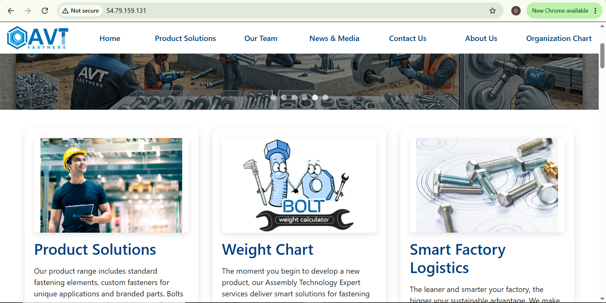
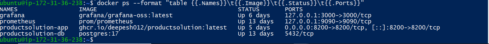
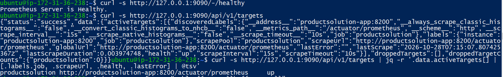
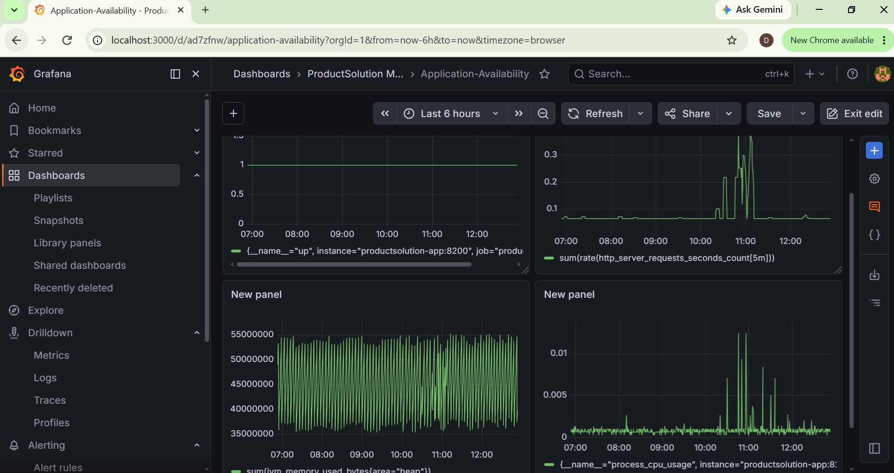
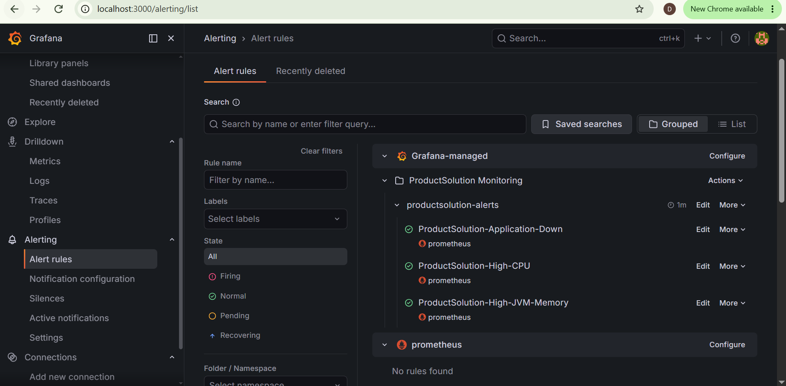
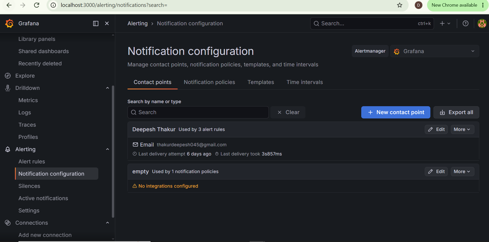
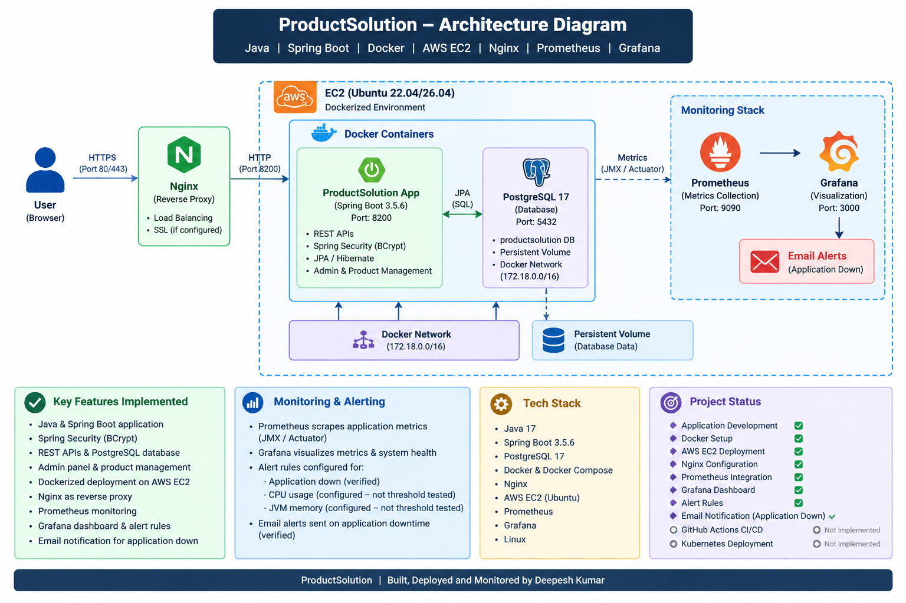

# Product Solution

**Product Solution** is a Java 17 and Spring Boot business website and content-management application. It allows authorized administrators to manage website content, products, images, banners, sliders, company information, and YouTube-related content through an admin panel.

The application is deployed on **AWS EC2 using Docker** and has a monitoring setup with **Prometheus and Grafana**. Grafana alerting is configured, and the application-down email notification has been verified.

## Highlights

- Java 17 and Spring Boot application
- Spring Security authentication with BCrypt password hashing
- PostgreSQL database with Spring Data JPA
- REST APIs for application functionality
- Dynamic admin panel for website content and product management
- Product and image management
- Contact/suggestion email functionality through Gmail SMTP
- Swagger/OpenAPI API documentation
- Dockerized application and PostgreSQL container
- AWS EC2 deployment behind Nginx
- Prometheus application-metrics scraping
- Grafana monitoring dashboard and alert rules
- Verified email notification for an application-down alert
- Configire CI/CD for automatic Deployment and Integrate using GitHub Actions

## Technology Stack

| Area | Technology |
|---|---|
| Language | Java 17 |
| Application framework | Spring Boot 3 |
| Security | Spring Security, BCrypt |
| Persistence | Spring Data JPA / Hibernate |
| Database | PostgreSQL 17 |
| UI | Thymeleaf |
| APIs | REST |
| API documentation | Swagger / OpenAPI |
| Build tool | Maven |
| Email | Gmail SMTP |
| Containers | Docker |
| Cloud | AWS EC2 |
| Web server / reverse proxy | Nginx |
| Metrics | Prometheus |
| Dashboards and alerting | Grafana |
| Server OS | Ubuntu Linux |

## Application Features

### Dynamic website content

Administrators can manage website content through the admin panel, including:

- Sliders and banners
- Product information and categories
- Product images and descriptions
- Company information
- YouTube-related content and other website sections

This lets administrators update supported content without changing application source code for each content update.

### Product and image management

The application supports product-management operations such as adding, editing, and deleting products, along with managing product information and images. Image files are stored on the application server, while relevant image paths or names are stored in PostgreSQL.

### Authentication and security

- Spring Security protects administrative functionality.
- BCrypt is used for password hashing.
- Administrative access is separated from normal public website access.
- **JWT is not part of the current implementation.**

### REST APIs and documentation

The application exposes REST endpoints for its supported features. The existing API organization includes admin, user, and public functionality. Swagger/OpenAPI is used to inspect and test available endpoints.

Swagger UI path:

```text
/swagger-ui/index.html
```

Admin sign-in path:

```text
/admin/signin
```

### Email functionality

The Contact Us / Suggestion functionality processes user messages and sends email through Gmail SMTP.

## Application Architecture

```text
Browser
  |
  v
Thymeleaf UI / REST APIs
  |
  v
Spring Boot Controllers
  |
  v
Service Layer
  |
  v
Spring Data JPA / Repositories
  |
  v
PostgreSQL
```

## AWS Deployment and Monitoring

The application is deployed on an AWS EC2 Ubuntu server. Docker is used to run the application and PostgreSQL in containers. Nginx is configured as the web entry point.

```text
Users
  |
  v
Nginx on AWS EC2
  |
  v
ProductSolution application container
  |
  v
PostgreSQL container

ProductSolution application metrics
  |
  v
Prometheus
  |
  v
Grafana dashboard and alert rules
  |
  v
Email notification
```

### Docker services

The deployed environment includes these services:

| Service | Purpose |
|---|---|
| `productsolution-app` | Spring Boot application |
| `productsolution-db` | PostgreSQL database |
| `prometheus` | Scrapes application metrics |
| `grafana` | Dashboards and alerting |

Prometheus is configured to scrape the application's Actuator Prometheus endpoint. The application target was verified as **UP**.

### Grafana monitoring

A combined Grafana dashboard has been created for application monitoring. It includes panels for:

- Application availability
- HTTP request rate
- JVM heap memory usage
- Process CPU usage

### Alerting status

| Alert | Status |
|---|---|
| `ProductSolution-Application-Down` | Configured; email delivery verified |
| `ProductSolution-High-CPU` | Configured |
| `ProductSolution-High-JVM-Memory` | Configured |

**Note:** The application-down email notification was verified end-to-end. The CPU and JVM-memory alerts are configured, but their threshold-triggering behavior has not been confirmed by a deliberate test.

## Run Locally

### Prerequisites

- Java 17
- Maven
- PostgreSQL
- Git

### 1. Clone the repository

```bash
git clone https://github.com/Deepesh012/productSolution.git
cd productSolution
```

### 2. Configure the application

Configure the database and email properties for your local environment. Example placeholders:

```properties
spring.datasource.url=jdbc:postgresql://localhost:5432/<database-name>
spring.datasource.username=<database-username>
spring.datasource.password=<database-password>

spring.mail.host=smtp.gmail.com
spring.mail.port=587
spring.mail.username=<gmail-address>
spring.mail.password=<gmail-app-password>
```

Use the property names expected by the project's configuration. Do not commit real passwords, app passwords, API keys, or other secrets to GitHub. Use environment variables or an appropriate secrets-management method for deployment.

### 3. Build and run

```bash
mvn clean install
mvn spring-boot:run
```

Use the application URL and port configured in the project. Swagger UI, when enabled, is available at:

```text
/swagger-ui/index.html
```

## Monitoring Access

Prometheus and Grafana are bound to the EC2 host's loopback interface in the current setup. For remote access, use an SSH tunnel rather than exposing their ports publicly.

Example for Grafana:

```bash
ssh -i "<path-to-your-key.pem>" -L 3000:127.0.0.1:3000 ubuntu@<EC2-public-IP>
```

Then open `http://localhost:3000` in your browser.

Example for Prometheus:

```bash
ssh -i "<path-to-your-key.pem>" -L 9090:127.0.0.1:9090 ubuntu@<EC2-public-IP>
```

Then open `http://localhost:9090`.

Replace the placeholders with your own key path and current EC2 address. Never upload your private key to the repository.

## Current Project Status

| Component | Status |
|---|---|
| Java / Spring Boot application | Implemented |
| Spring Security / BCrypt | Implemented |
| PostgreSQL persistence | Implemented |
| REST APIs and admin panel | Implemented |
| Product and website-content management | Implemented |
| Image management | Implemented |
| Gmail SMTP contact/suggestion email | Implemented |
| Swagger/OpenAPI | Implemented |
| Docker application and database containers | Deployed |
| AWS EC2 deployment | Deployed |
| Nginx | Configured |
| Prometheus application metrics | Scraping verified |
| Grafana monitoring dashboard | Created |
| Application-down email alert | Delivery verified |
| High-CPU and high-JVM-memory alerts | Configured |
| GitHub Actions CI/CD | Completed |

## Security Notes

- Never commit database credentials, Gmail app passwords, private SSH keys, or other secrets.
- Restrict database and monitoring ports; expose only the services that need public access.
- Keep application configuration and secrets separate from source code.
- Use HTTPS and review production security settings before using the application for sensitive workloads.

## Screenshots

### 1. ProductSolution Application


### 2. Docker Containers


### 3. Prometheus Target


### 4. Grafana Dashboard


### 5. Grafana Alert Rules


### 6. Email Alert


## System Architecture

The following diagram illustrates the application deployment, database connectivity, and monitoring architecture.


```


## Author

**Deepesh Kumar**

Java | Spring Boot | REST APIs | PostgreSQL | Docker | AWS | Linux | Prometheus | Grafana
